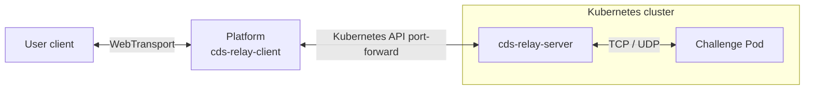

# cds-relay

A lightweight Rust TCP/UDP relay for platforms. A platform-side client opens one TCP connection or UDP association through an in-cluster server over a reliable bidirectional stream.



This repository implements the relay client, server, and wire protocol. The platform owns the WebTransport endpoint, challenge routing, Kubernetes resources, and port-forward connection pool.

## Workspace

| Crate | Purpose |
| --- | --- |
| `cds-relay-protocol` | Versioned handshake, connection status, and UDP framing |
| `cds-relay-client` | Client library accepting Tokio `AsyncRead + AsyncWrite + Unpin` streams |
| `cds-relay-server` | Tokio server library and standalone binary |

The client and server do not depend on Kubernetes, WebTransport, or a platform database. Each underlying stream carries one target and one transport protocol.

## Run locally

Requires Rust 1.85 or newer.

```sh
cargo test --workspace --all-targets --locked
cargo run -p cds-relay-server -- --listen 127.0.0.1:9527
```

In another terminal, start the local TCP/UDP echo targets, which bind to loopback:

```sh
python3 examples/echo.py
```

Send a message through the relay:

```sh
cargo run -p cds-relay-client --example probe -- tcp 127.0.0.1:9527 127.0.0.1:9000 hello
cargo run -p cds-relay-client --example probe -- udp 127.0.0.1:9527 127.0.0.1:9000 hello
```

The probe prints the first response chunk. It is a connectivity example, not a complete port-forwarding CLI.

## Platform integration

```rust,no_run
use cds_relay_client::Client;
use tokio::io::{AsyncRead, AsyncWrite};
use std::net::SocketAddr;

async fn connect<S>(stream: S, target: SocketAddr)
    -> Result<S, cds_relay_client::OpenError>
where
    S: AsyncRead + AsyncWrite + Unpin,
{
    // A kube port-forward data stream works without a local listening port.
    Client::default().open_tcp(stream, target).await
}
```

For UDP, call `Client::open_udp(stream, target).await?.split()` to obtain independent readers and writers, then use `recv()` and `send(&packet)`. Open a separate tunnel for each UDP flow. Each association keeps a stable target-side source socket and accepts multiple replies from the target.

The caller establishes the underlying stream. The client timeout covers the relay handshake and connection response. A failed handshake drops the supplied stream. Cancelling UDP `recv` preserves partial frame state so reading can resume. Cancelling or failing `send` after I/O begins poisons the writer; discard the entire tunnel.

The server processes at most one UDP packet per direction without an application queue. When integrating a shared WebTransport datagram receive loop, the platform must dispatch by flow, bound packet counts, queued bytes, and active associations, and drop packets when saturated so one flow cannot stall other users.

## Server options

| Option | Default | Description |
| --- | --- | --- |
| `--listen` | `127.0.0.1:9527` | Relay TCP listening address |
| `--max-connections` | `256` | Active connection limit across both protocols, including pending handshakes |
| `--handshake-timeout` | `5` | Timeout in seconds for reading the handshake and writing the response, measured separately |
| `--connect-timeout` | `5` | Target socket setup timeout in seconds |
| `--udp-idle-timeout` | `60` | UDP association idle timeout in seconds |
| `--check` | Disabled | Check that the listener accepts a TCP connection, then exit; does not check target health |

Connections over the limit close immediately. Established TCP connections have no idle timeout. Set `RUST_LOG=debug` to inspect session failures. Ctrl-C and SIGTERM close all sessions and wait for task cleanup; existing TCP connections do not survive shutdown.

## Container images

The [publish workflow](.github/workflows/publish.yaml) follows the main CdsCTF repository's Buildx, GHCR login, metadata, and cache configuration. It publishes `linux/amd64` images using `GITHUB_TOKEN` with `packages: write` permission. No additional registry secret is required for publishing to the repository's own GHCR package.

For a repository owned by `cdsctf`, images use `ghcr.io/cdsctf/relay`:

| Trigger | Image tags |
| --- | --- |
| Relevant changes pushed to `main`, or a manual run on `main` | `dev`, `sha-<short-commit>` |
| Stable version tag, such as `v0.1.0` or `0.1.0` | `0.1.0`, `0.1`, `latest`, `sha-<short-commit>` |

Release tags must match `[workspace.package].version` in `Cargo.toml`. Invalid or mismatched release tags fail before publishing. Forks publish under their own lowercased owner namespace while retaining the image name `relay`.

After the first successful publish, pull the development image with:

```sh
docker pull ghcr.io/cdsctf/relay:dev
```

GHCR packages are private on first publication. For anonymous cluster pulls, make the package public; otherwise configure registry credentials through `imagePullSecrets`. See [GitHub's Container registry documentation](https://docs.github.com/en/packages/working-with-a-github-packages-registry/working-with-the-container-registry#pushing-container-images).

To build a local image:

```sh
docker build -t ghcr.io/cdsctf/relay:dev .
```

## Kubernetes

The deployment example uses `ghcr.io/cdsctf/relay:dev` with `imagePullPolicy: Always`. Create the `cdsctf` namespace beforehand, then deploy after the image has been published:

```sh
kubectl apply -n cdsctf -f deploy/kubernetes.yaml
kubectl rollout status -n cdsctf deployment/cds-relay
kubectl port-forward -n cdsctf deployment/cds-relay 9527:9527
```

For reproducible deployments, replace `dev` with a release tag or digest. To use a locally built image with K3s, import it on every eligible node and set the deployment's `imagePullPolicy` to `Never`:

```sh
docker save ghcr.io/cdsctf/relay:dev | sudo k3s ctr images import -
```

The server binds only to `127.0.0.1:9527` inside the Pod. The manifest creates no Service, NodePort, or hostPort. Exec probes invoke the binary's `--check` option against the loopback listener. The Pod does not mount a ServiceAccount token, and the relay does not call the Kubernetes API.

The platform may run inside Kubernetes, in Docker, or as a local binary. It creates or selects the relay Pod through the Kubernetes API and obtains a port-forward stream, without requiring a route to the Pod network. Its credentials need the appropriate Deployment/Pod management and read permissions, plus access to `pods/portforward`. The commands above use kubectl for manual verification; the library does not spawn kubectl.

Use a shared Deployment per platform installation and cluster, with a distinct installation identifier. Keep it independent of individual challenge Pod lifecycles. Check image and protocol compatibility during upgrades; existing sessions are not migrated or restored.

## Protocol and limits

- Tunnels have no authentication or built-in TLS. The server binds to loopback by default; the platform and Kubernetes transport provide the surrounding connection. The platform resolves instance configuration to target IP addresses and ports.
- Targets use numeric IPv4/IPv6 addresses. Hostnames, IPv6 scope IDs, UDP broadcast/multicast, and multiple targets within one association are unsupported.
- TCP propagates half-closes while continuing to drain the opposite direction.
- UDP preserves datagram boundaries, including empty datagrams, with a maximum payload of 65,507 bytes. A successful open confirms socket setup rather than target reachability. `ConnectionRefused` errors from target ICMP rejection are treated as packet loss without retransmitting the packet.
- The backend uses a reliable stream: UDP packets may wait for retransmission, so this does not provide end-to-end native UDP latency semantics.
- WebTransport datagrams have a separate size limit. The platform and user client must agree on packet limits or fragmentation; the backend's 65,507-byte limit does not apply directly to the public endpoint.
- Connections are not replayed or reconnected automatically. The platform opens a new stream when needed. See the [wire protocol](docs/protocol.md).

The design draws on krelay's per-connection target selection and kftray's UDP session isolation, without copying their source code:

- [krelay](https://github.com/knight42/krelay/tree/017a53e63d11b9b53328f626ec38fd1206b31afc)
- [kftray](https://github.com/hcavarsan/kftray/tree/b870cb36a314b9d58a8425c8672dc89f0ee3e80c)

This is an initial prototype. Automated tests cover local TCP/UDP traffic, IPv6, session isolation, half-closes, timeouts, cancellation, framing limits, and task cleanup. Container execution and the Kubernetes path still need validation in the target deployment environment.
