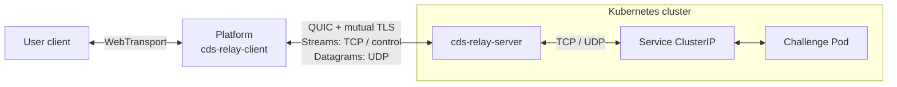

# cds-relay

A Rust TCP/UDP relay for platforms. The platform initiates a mutually authenticated QUIC connection to the relay. Each TCP connection uses an independent QUIC stream; UDP packets use unreliable QUIC DATAGRAMs. User traffic continues to pass through the platform.



This repository implements the relay client, server, credentials, and wire protocols. The platform owns the public WebTransport endpoint and target selection. A native QUIC backend is not a WebTransport server. The platform can run in Kubernetes, in Docker, or as a development binary, provided it can reach the relay's UDP listener. The relay does not initiate a connection to the platform.

QUIC is the only platform-to-relay transport. TCP and UDP describe the target-side protocols: the relay opens native TCP or UDP sockets to the selected Service. The server listens on UDP and requires a mutual TLS identity.

## Workspace

| Crate | Purpose |
| --- | --- |
| `cds-relay-protocol` | Versioned QUIC stream opening requests and status responses |
| `cds-relay-quic` | Mutual TLS configuration, credential files, stream adapter, and bounded datagram routing |
| `cds-relay-client` | Multiplexed QUIC client with TCP tunnels and UDP associations |
| `cds-relay-server` | Server libraries, identity generation, and standalone binary |

The workspace requires Rust 1.85 or newer. It does not depend on Kubernetes or a platform database.

## Run QUIC locally

Generate separate relay and platform credentials into a new directory:

```sh
cargo run -p cds-relay-server -- init --endpoint 127.0.0.1:9527
```

This creates `relay-identity/server.json` and `relay-identity/platform.json`. Keep the server file on the relay and give only the platform file to the platform. Both contain private keys. On Unix, the directory is created with mode `0700` and files with `0600`. Existing directories and files are never overwritten. The default directory is excluded from Git and the Docker build context.

Start the relay:

```sh
cargo run -p cds-relay-server -- --identity relay-identity/server.json --listen 127.0.0.1:9527
```

In another terminal, start the loopback TCP/UDP echo targets:

```sh
python3 examples/echo.py
```

Probe TCP and UDP from another terminal:

```sh
cargo run -p cds-relay-client --example quic_probe -- relay-identity/platform.json tcp 127.0.0.1:9000 hello
cargo run -p cds-relay-client --example quic_probe -- relay-identity/platform.json udp 127.0.0.1:9000 hello
```

The probes print the first response chunk. They are connectivity examples, not complete port-forwarding CLIs. UDP probes can time out if a datagram is lost.

## Platform integration

```rust,no_run
use cds_relay_client::{ClientCredentials, QuicClient};

async fn example() -> Result<(), Box<dyn std::error::Error>> {
    let credentials = ClientCredentials::read("/run/secrets/relay/platform.json")?;
    let relay = QuicClient::connect(&credentials).await?;

    // Reuse or clone this client for multiple TCP connections and UDP flows.
    let tcp = relay.open_tcp("10.42.0.12:8080".parse()?).await?;
    // tcp implements Tokio AsyncRead + AsyncWrite and supports half-close.

    let udp = relay.open_udp("10.42.0.12:5353".parse()?).await?;
    let (mut receiver, sender) = udp.split();
    let limit = sender.max_payload().ok_or("QUIC DATAGRAM unavailable")?;
    assert!(b"request".len() <= limit);
    sender.send(b"request")?;
    let response = receiver.recv().await?;
    Ok(())
}
```

`QuicClient` clones share one QUIC connection; tunnels retain its lifetime. Dropping either UDP half closes that association. Dropping the last client/tunnel closes the connection; `QuicClient::close()` immediately terminates every tunnel held by its clones. Failed connections are not automatically reconnected or replayed.

`connect_with_timeout` bounds the TLS handshake. Each subsequent open has the same total timeout covering stream capacity, request transmission, and the target-open response. Cancelling an open drops its stream. UDP receive is cancellation safe. `send` is synchronous and only enqueues a packet locally; it does not confirm delivery.

QUIC path MTU and the peer's DATAGRAM limit determine the UDP payload limit. Query `max_payload()` on a UDP tunnel/sender or `max_udp_payload()` on the client before sending. The limit can change. Oversized platform packets return an error; oversized target packets are dropped whole. There is no application fragmentation, reliable-stream fallback, or UDP retransmission. Each direction of the public WebTransport connection has its own size limit; the platform must account for both.

See the [QUIC guide](docs/quic.md) for credentials and limits, and the [wire protocols](docs/protocol.md) for framing and lifecycle.

## Server options

| Option | Default | Description |
| --- | --- | --- |
| `--listen` | `127.0.0.1:9527` | QUIC UDP listening address |
| `--identity` | Required | Relay identity JSON; required when serving |
| `--max-connections` | `256` | Independently caps pending/established QUIC connections and global target sessions |
| `--handshake-timeout` | `5` | Seconds for TLS authentication, reading each opening request, and writing its response, measured separately |
| `--connect-timeout` | `5` | Target socket setup timeout in seconds |
| `--udp-idle-timeout` | `60` | UDP association idle timeout in seconds |

QUIC allows at most 256 simultaneous target streams per connection, subject to the global target-session cap. Each connection has one datagram dispatcher and each UDP flow has a queue of at most 32 packets. Full queues discard incoming packets without blocking other flows. Quinn's receive/send datagram buffers are each capped at 256 KiB per connection; outgoing congestion may discard queued datagrams. These bounds do not provide fairness between hostile authenticated clients.

Established TCP tunnels have no application idle timeout. QUIC uses a 60-second transport idle timeout and a 15-second keepalive interval. Ctrl-C and SIGTERM close connections, cancel sessions, and wait for target-task cleanup. Set `RUST_LOG=debug` to inspect session failures.

## Container images

The [publish workflow](.github/workflows/publish.yaml) follows the main CdsCTF repository's Buildx, GHCR login, metadata, and cache configuration. It publishes `linux/amd64` images using `GITHUB_TOKEN` with `packages: write` permission. No additional registry secret is required for publishing to the repository's own GHCR package.

For a repository owned by `cdsctf`, images use `ghcr.io/cdsctf/relay`:

| Trigger | Image tags |
| --- | --- |
| Relevant changes pushed to `main`, or a manual run on `main` | `dev`, `sha-<short-commit>` |
| Stable version tag, such as `v0.1.0` or `0.1.0` | `0.1.0`, `0.1`, `latest`, `sha-<short-commit>` |

Release tags must match `[workspace.package].version` in `Cargo.toml`. Invalid or mismatched release tags fail before publishing. Forks publish under their own lowercased owner namespace while retaining the image name `relay`.

After the first successful publish, pull the development image with:

```sh
docker pull ghcr.io/cdsctf/relay:dev
```

GHCR packages are private on first publication. For anonymous cluster pulls, make the package public; otherwise configure registry credentials through `imagePullSecrets`. See [GitHub's Container registry documentation](https://docs.github.com/en/packages/working-with-a-github-packages-registry/working-with-the-container-registry#pushing-container-images).

To build a local image:

```sh
docker build -t ghcr.io/cdsctf/relay:dev .
```

The image runs as UID 65532. When mounting QUIC identities, grant that user read access to its server file without exposing the platform file. The container does not generate or embed credentials during its build.

## Kubernetes

The [deployment example](deploy/kubernetes.yaml) runs the QUIC relay on UDP port 9527, mounts `server.json` from the `cds-relay-identity` Secret, and provides an internal ClusterIP UDP Service. It mounts no ServiceAccount token and does not call the Kubernetes API. The relay can connect to target Services using their ClusterIP and Service port, subject to cluster networking and NetworkPolicy.

Create the `cdsctf` namespace beforehand. Generate an identity pair using an endpoint reachable from the platform, then create the server Secret and apply the manifest:

```sh
kubectl create secret generic cds-relay-identity -n cdsctf --from-file=server.json=relay-identity/server.json
kubectl apply -n cdsctf -f deploy/kubernetes.yaml
kubectl rollout status -n cdsctf deployment/cds-relay
```

Mount only `platform.json` into the platform. Its endpoint must match a relay UDP address that the platform can actually reach. An internal ClusterIP is appropriate when the platform has a route to the Service network. Access from an external Docker container or development binary requires a reachable UDP endpoint; exposure and routing remain separate deployment decisions. TCP port-forward cannot carry QUIC.

The Secret files are group-readable by the Pod's filesystem group (65532). The manifest defines no TCP listener, TCP health probes, NodePort, or hostPort. No application readiness/liveness probes are configured; rollout status alone does not validate an authenticated target connection. Use an authenticated probe with a known target for connectivity checks. Use a release tag or image digest for reproducible deployments.

## Scope and verification

Targets are numeric IPv4/IPv6 addresses with nonzero ports. Hostnames, IPv6 scope IDs, UDP broadcast/multicast, and multiple targets within one association are unsupported. Each UDP association has a separate connected target socket with a stable source port and accepts replies only from that target. Successful UDP open confirms local socket setup rather than target reachability. Target ICMP `ConnectionRefused` errors are treated as packet loss.

Mutual TLS authenticates the platform installation, not individual users or challenge access. The platform remains responsible for resolving and authorizing targets. Generated leaf certificates expire after 365 days; rotate both identity files together. Authentication does not prevent bandwidth exhaustion at a publicly reachable UDP endpoint.

```sh
cargo fmt --all -- --check
cargo clippy --workspace --all-targets --locked -- -D warnings
cargo test --workspace --all-targets --locked
```

Tests cover QUIC-only startup, protocol version rejection, real local QUIC connections, mutual TLS rejection, TCP half-close, UDP isolation and empty packets, size limits, queue pressure, idle expiry, capacity, IPv6, and shutdown. Production throughput, loss under real network conditions, container execution, and QUIC deployment still require validation in the target environment.

The session isolation design drew on [krelay](https://github.com/knight42/krelay/tree/017a53e63d11b9b53328f626ec38fd1206b31afc) and [kftray](https://github.com/hcavarsan/kftray/tree/b870cb36a314b9d58a8425c8672dc89f0ee3e80c), without copying their source code. The native QUIC transport uses [Quinn](https://github.com/quinn-rs/quinn) and [rustls](https://github.com/rustls/rustls).
