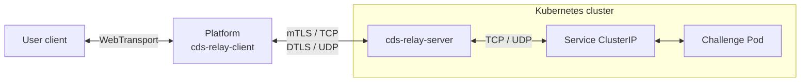

# cds-relay

A Rust TCP/UDP relay for platforms. The relay uses independent mTLS/TCP connections for TCP targets and DTLS/UDP associations for UDP targets. The platform initiates every association. User traffic continues to pass through the platform.



This repository implements the relay client, server, credentials, and wire protocols. The platform owns the public WebTransport endpoint and target selection. The backend transport is separate from the public WebTransport server. The platform can run in Kubernetes, in Docker, or as a development binary, provided it can reach both the relay's TCP and UDP listeners. The relay does not initiate a connection to the platform.

Native mode listens on TCP and UDP at the same numerical port. TCP streams and UDP packets have independent transport behavior; UDP application data never travels through TCP. Mutual TLS authenticates the installation and derives per-association DTLS keys. TLS/TCP and DTLS/UDP are the only supported platform-to-relay transports.

## Workspace

| Crate | Purpose |
| --- | --- |
| `cds-relay-protocol` | Versioned target opening requests and status responses |
| `cds-relay-native` | Native TLS/TCP client, DTLS/UDP sessions, and bounded datagram routing |
| `cds-relay-client` | `RelayClient` / `NativeClient` SDK and connectivity example |
| `cds-relay-server` | Server libraries, identity generation, and standalone binary |

The workspace requires Rust 1.85 or newer. It does not depend on Kubernetes or a platform database.

## Run locally

Generate separate relay and platform credentials into a new directory:

```sh
cargo run -p cds-relay-server -- init --endpoint 127.0.0.1:9527
```

This creates `relay-identity/server.json` and `relay-identity/platform.json`. Keep the server file on the relay and give only the platform file to the platform. Both contain private keys. On Unix, the directory is created with mode `0700` and files with `0600`. Existing directories and files are never overwritten. The default directory is excluded from Git and the Docker build context.

Start the relay:

```sh
cargo run -p cds-relay-server -- --identity relay-identity/server.json --listen 127.0.0.1:9527
```

In another terminal, start the loopback TCP/UDP echo targets:

```sh
python3 examples/echo.py
```

Probe TCP and UDP from another terminal:

```sh
cargo run -p cds-relay-client --example native_probe -- relay-identity/platform.json tcp 127.0.0.1:9000 hello
cargo run -p cds-relay-client --example native_probe -- relay-identity/platform.json udp 127.0.0.1:9000 hello
```

The probes print the first response chunk. They are connectivity examples, not complete port-forwarding CLIs. UDP probes can time out if a datagram is lost.

## Platform integration

```rust,no_run
use cds_relay_client::{ClientCredentials, RelayClient};

async fn example() -> Result<(), Box<dyn std::error::Error>> {
    let credentials = ClientCredentials::read("/run/secrets/relay/platform.json")?;
    let relay = RelayClient::connect(&credentials).await?;

    // Reuse or clone this client for multiple TCP connections and UDP flows.
    let tcp = relay.open_tcp("10.42.0.12:8080".parse()?).await?;
    // tcp implements Tokio AsyncRead + AsyncWrite and supports half-close.

    let udp = relay.open_udp("10.42.0.12:5353".parse()?).await?;
    let (mut receiver, sender) = udp.split();
    let limit = sender.max_payload().ok_or("UDP unavailable")?;
    assert!(b"request".len() <= limit);
    sender.send(b"request").await?;
    let response = receiver.recv().await?;
    Ok(())
}
```

`RelayClient` is an alias for `NativeClient`. Clones reuse local TLS configuration;
each target gets an independent connection. Construction validates credentials;
network authentication occurs during `open_tcp` / `open_udp`. The open timeout
covers connection setup, mutual TLS, target opening, and (for UDP) DTLS setup.
Dropping a client does not terminate existing tunnels. Dropping either UDP half
closes that association. Cancelling a receive does not close it. UDP `send` is
asynchronous and confirms a local write, not remote delivery.

The native UDP payload limit is 1,152 bytes. Query `max_payload()` before sending.
Oversized platform packets return an error; oversized target packets are dropped
whole. No application fragmentation, retransmission, or TCP fallback is used.
The public WebTransport hop has its own size limits. See the
[native transport guide](docs/native.md) for framing, authentication, key lifetime,
and NAT restrictions.

## Server options

| Option | Default | Description |
| --- | --- | --- |
| `--listen` | `127.0.0.1:9527` | TCP and UDP address |
| `--identity` | Required | Relay identity JSON; required when serving |
| `--max-connections` | `256` | Caps sessions including pending TLS/DTLS setup |
| `--handshake-timeout` | `5` | Combined TLS/open-header deadline and separate UDP setup deadline, in seconds |
| `--connect-timeout` | `5` | Target socket setup timeout in seconds |
| `--udp-idle-timeout` | `60` | UDP association idle timeout in seconds |
| `--tcp-rate-limit-mbps` | `0` | Relay-wide TCP payload ceiling per direction; 0 disables pacing |
| `--udp-max-queue-delay-ms` | `0` | Expiry in relay receive-dispatch queues; 0 disables expiry |

See [relay-only traffic control](docs/traffic-control.md) for aggregate TCP
pacing and the limits of receive-queue expiry. Both are optional and disabled
by default.

Native UDP dispatch has 128 packets per association and a shared 1 MiB queued
ciphertext budget across the server. A full queue or exhausted byte budget drops
packets without blocking other associations. Unknown associations receive no
response and allocate no session state. Established TCP tunnels have no
application idle timeout; inactive UDP targets expire after 60 seconds by default.
Ctrl-C and SIGTERM cancel sessions and wait for target-task cleanup.

## Container images

The [publish workflow](.github/workflows/publish.yaml) follows the main CdsCTF repository's Buildx, GHCR login, metadata, and cache configuration. It publishes `linux/amd64` images using `GITHUB_TOKEN` with `packages: write` permission. No additional registry secret is required for publishing to the repository's own GHCR package.

For a repository owned by `cdsctf`, images use `ghcr.io/cdsctf/relay`:

| Trigger | Image tags |
| --- | --- |
| Relevant changes pushed to `main`, or a manual run on `main` | `dev`, `sha-<short-commit>` |
| Stable version tag, such as `v0.1.0` or `0.1.0` | `0.1.0`, `0.1`, `latest`, `sha-<short-commit>` |

Release tags must match `[workspace.package].version` in `Cargo.toml`. Invalid or mismatched release tags fail before publishing. Forks publish under their own lowercased owner namespace while retaining the image name `relay`.

After the first successful publish, pull the development image with:

```sh
docker pull ghcr.io/cdsctf/relay:dev
```

GHCR packages are private on first publication. For anonymous cluster pulls, make the package public; otherwise configure registry credentials through `imagePullSecrets`. See [GitHub's Container registry documentation](https://docs.github.com/en/packages/working-with-a-github-packages-registry/working-with-the-container-registry#pushing-container-images).

To build a local image:

```sh
docker build -t ghcr.io/cdsctf/relay:dev .
```

The image runs as UID 65532. When mounting identities, grant that user read access to its server file without exposing the platform file. The container does not generate or embed credentials during its build.

## Kubernetes

The [deployment example](deploy/kubernetes.yaml) runs the native relay on TCP and UDP port 9527, mounts `server.json` from the `cds-relay-identity` Secret, and provides an internal ClusterIP Service with both protocols. It mounts no ServiceAccount token and does not call the Kubernetes API. The relay can connect to target Services using their ClusterIP and Service port, subject to cluster networking and NetworkPolicy.

Create the `cdsctf` namespace beforehand. Generate an identity pair using an endpoint reachable from the platform, then create the server Secret and apply the manifest:

```sh
kubectl create secret generic cds-relay-identity -n cdsctf --from-file=server.json=relay-identity/server.json
kubectl apply -n cdsctf -f deploy/kubernetes.yaml
kubectl rollout status -n cdsctf deployment/cds-relay
```

Mount only `platform.json` into the platform. Its endpoint must match a relay TCP/UDP address that the platform can actually reach. An internal ClusterIP is appropriate when the platform has a route to the Service network. Access from an external Docker container or development binary requires reachable TCP and UDP endpoints at the same numerical port; exposure and routing remain separate deployment decisions. TCP port-forward alone cannot carry the native UDP channel.

The Secret files are group-readable by the Pod's filesystem group (65532). The manifest defines no NodePort or hostPort. It uses a TCP readiness probe, one replica, and `Recreate` updates. TCP and UDP for an association must reach the same relay process; ordinary multi-replica load balancing is unsupported without cross-protocol affinity. Replacement interrupts tunnels, and clients must reopen them after Service endpoint convergence. Readiness alone does not validate an authenticated target connection. Use an authenticated probe with a known target for connectivity checks and a release tag or image digest for reproducible deployments.

## Scope and verification

Targets are numeric IPv4/IPv6 addresses with nonzero ports. Hostnames, IPv6 scope IDs, UDP broadcast/multicast, and multiple targets within one association are unsupported. Each UDP association has a separate connected target socket with a stable source port and accepts replies only from that target. Successful UDP open confirms local socket setup rather than target reachability. Target ICMP `ConnectionRefused` errors are treated as packet loss.

Mutual TLS authenticates the platform installation, not individual users or challenge access. The platform remains responsible for resolving and authorizing targets. Generated leaf certificates expire after 365 days; rotate both identity files together. Authentication does not prevent bandwidth exhaustion at a publicly reachable UDP endpoint.

```sh
cargo fmt --all -- --check
cargo clippy --workspace --all-targets --locked -- -D warnings
cargo test --workspace --all-targets --locked
```

Tests cover native TLS/DTLS authentication and shutdown, TCP half-close, UDP empty packets and isolation, forged packets, stalled setup, cancellation, payload limits, idle expiry, IPv6, and capacity. Deployment capacity and WAN quality require measurement on the intended path.

The [experiment conclusions](docs/experiments.md) retain the findings behind
the transport choice, including failed latency targets and deployment recovery
limitations. Historical benchmark tools, prototypes, raw data, and QUIC support
have been removed.

The session isolation design drew on
[krelay](https://github.com/knight42/krelay/tree/017a53e63d11b9b53328f626ec38fd1206b31afc)
and [kftray](https://github.com/hcavarsan/kftray/tree/b870cb36a314b9d58a8425c8672dc89f0ee3e80c),
without copying their source code. TLS uses rustls; DTLS uses webrtc-dtls.
