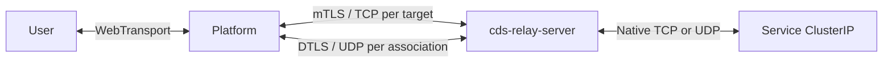

# Native TLS/TCP and DTLS/UDP backend

The server binds **TCP and UDP at the same numerical port**.
The platform initiates every connection. Target sockets remain on the relay,
so user traffic still passes through the platform before reaching same-namespace
Service ClusterIPs. The platform can run as a binary, Docker container, or Pod
if both relay listeners are reachable. No TUN device, network administration
capability, Kubernetes API access, or relay-to-platform dialback is required.



## Running

```sh
cds-relay-server init --endpoint 127.0.0.1:9527 --out relay-identity
cds-relay-server --identity relay-identity/server.json --listen 0.0.0.0:9527
```

Credentials use the v2 JSON format and installation trust roots. Their endpoint
must reach **both protocols**
at the same public numerical port, including through any NAT, load balancer,
or NodePort mapping.

```rust,no_run
use cds_relay_client::{ClientCredentials, RelayClient};

async fn example() -> std::io::Result<()> {
    let credentials = ClientCredentials::read("platform.json")?;
    let client = RelayClient::connect(&credentials).await?;
    let tcp = client.open_tcp("10.43.0.10:8080".parse().unwrap()).await?;
    let udp = client.open_udp("10.43.0.11:5353".parse().unwrap()).await?;
    udp.send(b"request").await?;
    Ok(())
}
```

Client construction validates local credentials; network authentication occurs
when opening a target. Each open has a total timeout, including DTLS setup for
UDP. Clones share TLS configuration, not a multiplexed data connection. Existing
tunnels outlive the client handle. Dropping either UDP half closes its control
connection and association. Receive cancellation preserves the association.

For Docker, publish both `-p 9527:9527/tcp` and `-p 9527:9527/udp`. The
[Kubernetes example](../deploy/kubernetes.yaml) exposes both Service protocols
and runs without a service account token or network capabilities. TCP and UDP
for one association must reach the **same relay process**. The
example uses one replica with `Recreate` updates to avoid routing the two
protocols to different Pods during a rolling update. Multiple independent
replicas behind an ordinary load-balanced Service are unsupported without
cross-protocol backend affinity. Replacement still interrupts active tunnels;
platforms must open fresh associations after Service endpoints converge.
A TCP-only port-forward supports TCP targets but cannot carry the UDP channel.

## Authentication and setup

Each target first establishes TLS 1.3 with mutual certificate verification and
ALPN `cds-relay-native/1`. TLS resumption is disabled on the client. The existing
v2 [opening header](protocol.md) selects the numeric target and TCP/UDP type.
Unauthenticated clients cannot open target sockets. Target authorization and
individual user identity remain platform responsibilities.

For TCP, a success status is followed by application bytes over that independent
TLS/TCP connection. TCP half-close and replies after request EOF are preserved.
Bulk TCP is not multiplexed onto a single outer TCP stream.

For UDP, the relay binds a connected target socket, registers a random 128-bit
association ID, and returns success followed by the 16-byte ID. Both peers
derive a fresh 32-byte PSK with the TLS 1.3 exporter, label
`EXPORTER-cds-relay-native-dtls-v1`, using the ID as context. The ID is a routing
identifier, not a secret or bearer credential.

The peers then establish **DTLS 1.2**, using the `webrtc-dtls` crate,
the exporter-derived PSK, `TLS_PSK_WITH_AES_128_GCM_SHA256`, and required Extended
Master Secret. This implementation does not claim DTLS 1.3 support. Its DTLS
PSK identity is the exact association ID. After its DTLS handshake succeeds,
the relay writes a final zero ready byte on the TLS control connection. Only
then does `open_udp` return. The TLS control channel carries setup/lifetime
information, never UDP application payload.

## UDP framing and lifecycle

Every outer UDP packet contains a 16-byte association ID followed by a DTLS
datagram. Encrypted DTLS application records contain a one-byte type:

| Type | Body | Meaning |
| --- | --- | --- |
| `0` | 0–1,152 bytes | One complete target UDP packet, including empty packets |
| `1` | Empty | Client keepalive, not forwarded or counted as target activity |

Application records are not retransmitted, reassembled across packets, or
held for missing sequence numbers. DTLS handles authentication and replay
protection, with a 256-record replay window; extreme reordering beyond that
window can be dropped. Empty target packets use a type-only encrypted record.
Oversized outgoing platform payloads return an error. Oversized target replies
are discarded whole. There is no reliable-stream fallback or fragmentation.

The current 1,152-byte payload bound fits DTLS and routing overhead beneath the
IPv6 minimum MTU. It is a conservative fixed bound, not active PMTU discovery;
paths that cannot carry the resulting UDP packet need separate remediation.

The dispatcher accepts registered IDs only, requires the UDP source IP to match
the TLS peer, and pins the first UDP source port. This supports ordinary NAT
with matching TCP/UDP egress IPs, but not split egress, transparent NAT rebinding,
or roaming. Address pinning is not a substitute for DTLS authentication; an
active attacker who knows the ID can still disrupt setup. Only authenticated
DTLS data can reach the target. The client sends a DTLS keepalive every 15 s
to preserve an idle NAT mapping. Keepalives do not extend target idle expiry.

Control-channel EOF/errors, dropping either client half, target idle expiry,
setup failure, or shutdown release the association. Keys are not serialized or
logged. This version closes an association after a conservative 2^24 outbound
application records, including client keepalives. Reopen it to derive fresh
keys. Transparent rekey and automatic reconnection are not implemented, and
long-lived high-packet-rate applications must account for this limit.

## Resources and traffic behavior

The global session limit includes pending TLS/DTLS setup and established targets.
Each UDP association has a 128-packet ingress queue; all server queues share a
1 MiB ciphertext budget. Incoming outer datagrams over 1,232 bytes are dropped.
Full queues drop packets without blocking other associations. Debug logs expose
unknown-ID, queue-full, shared-budget, and optional receive-expiry counters.
They do not count every kernel/network/DTLS rejection.

Kernel TCP provides its own congestion control and socket backpressure. Native
UDP and DTLS do not add data acknowledgements or congestion control.
Separating TCP and UDP does not reserve physical network
capacity or make arbitrary UDP offered loads safe. A provisioned private backend
must size/admit its aggregate traffic; public Internet deployments need an
appropriate UDP congestion/fairness policy. Native mode is not a claim that UDP
can exceed the bottleneck without losses.

The optional `--tcp-rate-limit-mbps` still limits TCP payload per direction
across the process; it defaults to unlimited. Kernel TCP uses the host
congestion controller. Optional
`--udp-max-queue-delay-ms` expires only the relay's raw receive-dispatch queue;
it is not an end-to-end deadline or an outgoing-DTLS queue deadline.

TCP and UDP use separate transport paths, but quality under mixed load still
depends on kernel/network queues, CPU,
available capacity, and application traffic. Compare TCP goodput, UDP loss,
and UDP tail latency together before declaring a deployment's supported load.

See the [experiment conclusions](experiments.md) for measured results, including
failed mixed-load latency gates.
